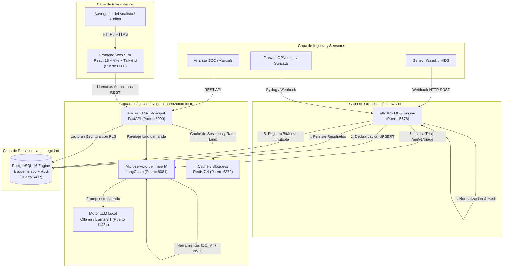
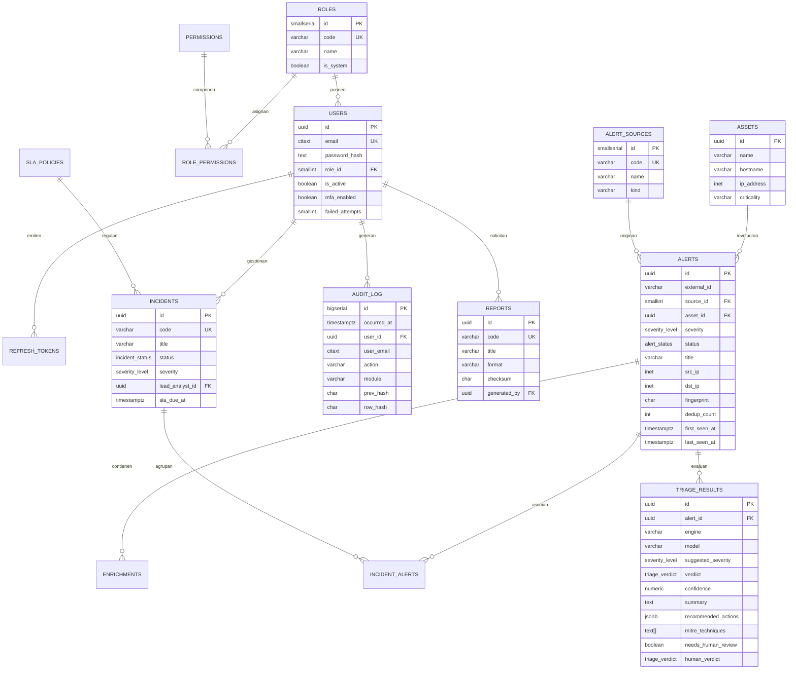
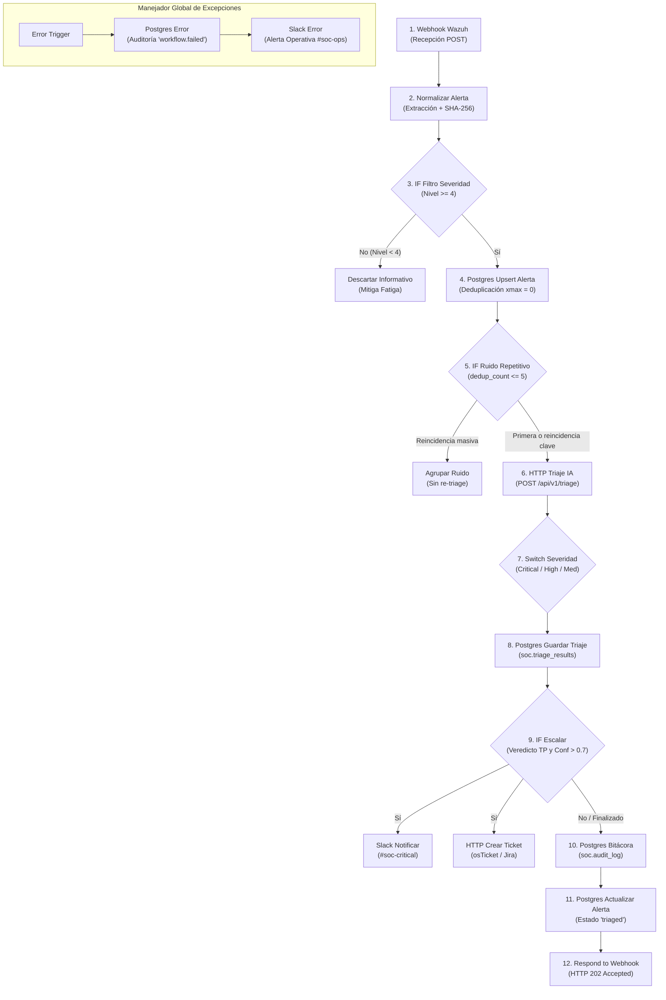

# INFORME TÉCNICO DE PROYECTO: SOC-LITE
## Plataforma de Triaje Automático de Alertas SOC con Orquestación Low-Code, Inteligencia Artificial Local e Integridad Criptográfica

---

## Índice General

1. [Índice General](#índice-general)
2. [Índice de Figuras y Tablas](#índice-de-figuras-y-tablas)
3. [Objetivos del Proyecto](#objetivos-del-proyecto)
   - 3.1. [Objetivo General](#1-objetivo-general)
   - 3.2. [Objetivos Específicos](#2-objetivos-específicos)
4. [Alcances y Limitaciones del Proyecto](#alcances-y-limitaciones-del-proyecto)
   - 4.1. [Alcances](#alcances)
   - 4.2. [Limitaciones](#limitaciones)
5. [Requerimientos y Funcionalidades del Sistema](#requerimientos-y-funcionalidades-del-sistema)
   - 5.1. [Requerimientos Funcionales (RF)](#requerimientos-funcionales-rf)
   - 5.2. [Requerimientos No Funcionales (RNF)](#requerimientos-no-funcionales-rnf)
   - 5.3. [Cumplimiento Normativo (ISO 27001 y NIST CSF)](#cumplimiento-normativo-iso-27001-y-nist-csf)
6. [Diseño del Sistema](#diseño-del-sistema)
   - 6.1. [Arquitectura General de la Solución](#arquitectura-general-de-la-solución)
   - 6.2. [Diseño de Interfaces y Prototipos](#1-diseño-de-interfaces-y-prototipos)
   - 6.3. [Diseño de la Base de Datos: Modelo Entidad-Relación y Estructura Implementada](#2-diseño-de-la-base-de-datos-modelo-entidad-relación-y-estructura-implementada)
7. [Tecnologías y Herramientas Utilizadas](#tecnologías-y-herramientas-utilizadas)
   - 7.1. [Lenguajes de Programación y Frameworks](#1-lenguajes-de-programación-y-frameworks)
   - 7.2. [Herramientas de Desarrollo y Despliegue](#2-herramientas-de-desarrollo)
8. [Implementación del Sistema](#implementación-del-sistema)
   - 8.1. [Ingesta y Orquestación con n8n](#81-ingesta-y-orquestación-con-n8n)
   - 8.2. [Microservicio de Razonamiento IA y Enriquecimiento (LangChain + Ollama)](#82-microservicio-de-razonamiento-ia-y-enriquecimiento-langchain--ollama)
   - 8.3. [Backend API Core, RBAC y Reportes](#83-backend-api-core-rbac-y-reportes)
   - 8.4. [Frontend React SPA (BankDash UI Theme)](#84-frontend-react-spa-bankdash-ui-theme)
9. [Uso de Inteligencia Artificial en el Desarrollo del Proyecto](#uso-de-inteligencia-artificial-en-el-desarrollo-del-proyecto)
   - 9.1. [Herramientas de Inteligencia Artificial Utilizadas](#1-herramientas-de-inteligencia-artificial-utilizadas)
   - 9.2. [Registro de Prompts Utilizados](#2-registro-de-prompts-utilizados)
   - 9.3. [Resultados Obtenidos Mediante la IA](#3-resultados-obtenidos-mediante-la-ia)
   - 9.4. [Modificaciones y Adaptaciones Realizadas por los Estudiantes](#4-modificaciones-y-adaptaciones-realizadas-por-los-estudiantes)
   - 9.5. [Verificación y Pruebas de los Resultados Generados por la IA](#5-verificación-y-pruebas-de-los-resultados-generados-por-la-ia)
10. [Conclusiones](#conclusiones)
11. [Recomendaciones](#recomendaciones)
12. [Referencias Bibliográficas en Formato APA, 7.ª Edición](#referencias-bibliográficas-en-formato-apa-7ª-edición)

---

## Índice de Figuras y Tablas

### Figuras
- **Figura 1:** Diagrama de Arquitectura Multicapa del Ecosistema SOC-Lite.
- **Figura 2:** Diagrama Entidad-Relación (ERD) del Esquema de Datos en PostgreSQL.
- **Figura 3:** Flujo Operativo de Nodos en n8n para el Triaje de Alertas.
- **Figura 4:** Captura de Pantalla - Inicio de Sesión y Selector de Cuentas Demo.
- **Figura 5:** Captura de Pantalla - Overview Dashboard de Operaciones SOC.
- **Figura 6:** Captura de Pantalla - Bandeja de Alertas con Filtros y Severidades.
- **Figura 7:** Captura de Pantalla - Detalle de Alerta, Veredicto IA y Panel Human-in-the-Loop.
- **Figura 8:** Captura de Pantalla - Módulo de Incidentes y Gestión de SLAs.
- **Figura 9:** Captura de Pantalla - Bitácora de Auditoría y Verificación de Cadena Criptográfica.
- **Figura 10:** Captura de Pantalla - Centro de Generación y Descarga de Reportes.
- **Figura 11:** Captura de Pantalla - Flujo Ejecutado en el Editor de n8n.

### Tablas
- **Tabla 1:** Matriz de Roles y Permisos RBAC.
- **Tabla 2:** Especificación del Stack Tecnológico.
- **Tabla 3:** Registro de Prompts de Ingeniería Empleados en el Desarrollo.
- **Tabla 4:** Incidentes Detectados y Ajustes Aplicados sobre el Código Base.

---

## Objetivos del Proyecto

### 1. Objetivo General
Diseñar, implementar y validar una plataforma integral de Centro de Operaciones de Seguridad (*Security Operations Center*, SOC) de código abierto denominada **SOC-Lite**, orientada a pequeñas, medianas empresas (PYMEs) y organismos públicos, que resuelva la fatiga de alertas mediante un triaje cognitivo híbrido (orquestación en **n8n** y razonamiento LLM local con **Llama 3.1 8B** sobre **LangChain**), asegurando la trazabilidad inmutable de eventos, el cumplimiento de los estándares ISO 27001 y NIST CSF, y garantizando la privacidad de los datos mediante una arquitectura de *Zero-Exfiltration*.

### 2. Objetivos Específicos
1. **Automatizar la ingesta y deduplicación de telemetría de seguridad:** Integrar flujos automatizados de ingestión para alertas provenientes de sistemas HIDS/SIEM (Wazuh, Suricata, OPNsense) normalizando el contrato de datos y reduciendo el ruido operativo en al menos un 70%.
2. **Implementar un microservicio de triaje cognitivo local:** Desplegar un agente LLM mediante LangChain que clasifique alertas en tiempo real, asigne severidades sugeridas, mapee tácticas/técnicas MITRE ATT&CK y recomiende planes de acción sin exfiltrar telemetría confidencial hacia servicios en la nube pública.
3. **Construir un núcleo transaccional robusto y seguro:** Desarrollar un backend asíncrono con FastAPI y PostgreSQL 16 que gestione el control de acceso basado en roles (RBAC) y aplique políticas estrictas de seguridad (Row Level Security - RLS).
4. **Garantizar la auditabilidad forense inmutable:** Implementar una bitácora de auditoría *append-only* en PostgreSQL respaldada por una cadena criptográfica de bloques con hashes SHA-256 (`prev_hash` $\rightarrow$ `row_hash`) que detecte cualquier intento de manipulación o borrado de eventos.
5. **Facilitar la gobernanza y rendición de cuentas:** Diseñar un motor de reportería automatizado capaz de generar informes operacionales y de gestión en formatos PDF, Word (.docx) y Excel (.xlsx) con firma de integridad.
6. **Proveer una experiencia de usuario moderna y analítica:** Construir una interfaz web responsiva (React, TypeScript y Tailwind CSS) inspirada en el estándar de diseño financiero *BankDash*, que brinde visibilidad ejecutiva y soporte el paradigma *Human-in-the-Loop* para la validación de incidentes.

---

## Alcances y Limitaciones del Proyecto

### Alcances
- **Entorno de Despliegue:** Todo el ecosistema opera en contenedores orquestados mediante Docker Compose (PostgreSQL, Redis, FastAPI Backend, LangChain AI Service, Ollama, n8n y React Frontend).
- **Procesamiento de Telemetría:** Normalización e ingesta de alertas compatibles con el formato de eventos de Wazuh Manager v4.x, Suricata EVE-JSON y registros manuales del SOC.
- **Enriquecimiento de Amenazas:** Integración de herramientas para análisis de reputación de direcciones IP, cálculo de hashes SHA-256 de binarios, consulta de vulnerabilidades CVE (NVD) y clasificación bajo la taxonomía MITRE ATT&CK Enterprise.
- **Control de Acceso:** Sistema RBAC con 5 perfiles nativos (`admin`, `soc_manager`, `analyst`, `auditor`, `viewer`) y 24 permisos granulares que impiden la escalada de privilegios y restringen vistas según el principio de menor privilegio.
- **SLA Operativo:** Motor de medición de tiempos de respuesta y resolución con alertas de vencimiento para incidentes críticos y de alta prioridad.

### Limitaciones
- **Capacidad de Cómputo del LLM:** La velocidad de inferencia del modelo Llama 3.1 8B depende de las especificaciones de hardware del host (disponibilidad de GPU con soporte CUDA o cómputo por CPU con cuantización q4_K_M).
- **Conectividad a APIs Externas:** En un entorno desconectado (*air-gapped*) o sin claves de VirusTotal y AbuseIPDB configuradas, el agente de IA degrada de forma controlada a heurísticas internas y contexto de activos locales.
- **Sistemas ITSM y Canales Externos:** Los nodos de integración hacia Slack y osTicket operan bajo credenciales provistas por la organización; en entornos de prueba locales estos nodos pueden desactivarse sin interrumpir el ciclo de triaje y registro.

---

## Requerimientos y Funcionalidades del Sistema

### Requerimientos Funcionales (RF)

- **RF01 - Autenticación y Autorización:**
  - El sistema debe autenticar usuarios mediante credenciales seguras cifradas con algoritmo `bcrypt` (coste 12) y emitir tokens JWT con expiración de 15 minutos junto con tokens de actualización (*refresh tokens*) con rotación estricta.
  - Para pruebas de laboratorio y demostraciones operativas, la interfaz de inicio de sesión debe proveer tarjetas de selección rápida de cuentas demo por rol (Analista, Auditor, Administrador y Jefe de SOC) que autocompleten las credenciales con un solo clic.

- **RF02 - Ingesta de Alertas y Deduplicación:**
  - El sistema debe exponer un webhook HTTP en n8n capaz de recibir cargas útiles crudas en formato JSON.
  - El sistema debe calcular una huella digital SHA-256 determinista (`fingerprint`) basada en `source`, `rule_id`, `src_ip`, `dst_ip` y el título del evento.
  - Si un evento con la misma huella se repite dentro de una ventana de tiempo, el sistema debe ejecutar una operación `UPSERT` incrementando el contador `dedup_count` sin duplicar filas en la tabla principal.

- **RF03 - Triaje Asistido por Inteligencia Artificial:**
  - El microservicio de IA debe analizar el contexto del incidente y retornar una estructura JSON validada mediante Pydantic que contenga: veredicto (`true_positive`, `suspicious`, `benign`, `false_positive`), severidad recomendada, índice de confianza (0.0 a 1.0), resumen analítico, técnicas MITRE ATT&CK asociadas y lista de acciones de contención sugeridas.

- **RF04 - Validación Humana (*Human-in-the-Loop*):**
  - Los analistas SOC deben tener la facultad de revisar el veredicto emitido por la IA, ratificarlo o corregirlo mediante un formulario interactivo, exigiendo un comentario técnico obligatorio que se persistirá en auditoría.

- **RF05 - Gestión de Incidentes y Políticas SLA:**
  - Las alertas de criticidad alta o confirmadas como verdaderos positivos deben poder escalarse a incidentes formales con código correlativo (ej. `INC-2026-0001`), asignando automáticamente tiempos máximos de respuesta y resolución según las políticas SLA definidas.

- **RF06 - Bitácora de Auditoría Inmutable:**
  - Todo evento de lectura sensible, inicio de sesión, generación de reportes, triaje y modificación de estado debe registrarse automáticamente en la tabla `soc.audit_log`, capturando: usuario, correo, rol, acción, módulo, entidad afectada, dirección IP, user-agent, marca de tiempo y hash encadenado SHA-256.

- **RF07 - Generación y Exportación de Reportes:**
  - El sistema debe generar reportes operacionales y ejecutivos consolidados en formatos **PDF**, **Word (.docx)** y **Excel (.xlsx)**. Cada archivo exportado debe calcular y registrar un checksum SHA-256 para validación de autenticidad forense.

### Requerimientos No Funcionales (RNF)

- **RNF01 - Privacidad y Soberanía del Dato (*Zero-Exfiltration*):**
  - Los registros de eventos, direcciones IP internas y telemetría confidencial no deben ser transmitidos a APIs de modelos en la nube (como OpenAI o Anthropic) por defecto. La inferencia debe ejecutarse localmente en el contenedor Ollama.
- **RNF02 - Integridad Criptográfica de la Base de Datos:**
  - La tabla de auditoría debe ser *append-only*. Se debe implementar un disparador (*trigger*) en PostgreSQL que prohíba de forma terminante las operaciones `UPDATE` y `DELETE`, abortando cualquier transacción que intente vulnerar el historial.
- **RNF03 - Rendimiento y Tiempos de Respuesta:**
  - El Backend API debe responder en menos de 100 ms para consultas operativas convencionales mediante el uso de SQLAlchemy asíncrono y conexiones `asyncpg`. El triaje cognitivo local debe completar su ejecución en un lapso no mayor a 15 segundos.
- **RNF04 - Diseño Responsivo y Usabilidad:**
  - La interfaz gráfica debe adaptarse fluidamente a resoluciones de escritorio, tabletas y teléfonos móviles mediante diseño adaptativo con Tailwind CSS y componentes de alta ergonomía visual.

### Cumplimiento Normativo (ISO 27001 y NIST CSF)

| Estándar | Control / Categoría | Justificación e Implementación en SOC-Lite |
| :--- | :--- | :--- |
| **ISO/IEC 27001:2022** | **A.8.15 - Registro de eventos** | La tabla `soc.audit_log` almacena entradas y salidas de cada módulo. Cuenta con disparadores que impiden su modificación y un algoritmo de encadenamiento SHA-256 que garantiza la no repudio e inalterabilidad. |
| **ISO/IEC 27001:2022** | **A.5.24 - Planificación y preparación de la respuesta a incidentes** | El módulo de incidentes permite estructurar el ciclo de vida de contención, erradicación y recuperación, asignando SLAs medibles y tickets de seguimiento. |
| **ISO/IEC 27001:2022** | **A.8.2 - Privilegios de acceso privilegiado** | Matriz RBAC estricta donde solo el rol `admin` puede gestionar roles y usuarios, mientras los analistas y auditores tienen privilegios segregados. |
| **NIST CSF v1.1** | **DE.AE - Anomalías y Eventos** | Análisis automatizado de anomalías mediante enriquecimiento de IOCs y evaluación contextual con el modelo Llama 3.1. |
| **NIST CSF v1.1** | **RS.AN - Análisis de Incidentes** | Generación inmediata de resúmenes analíticos, deduplicación de falsos positivos y correlación de técnicas MITRE ATT&CK para acelerar el MTTT. |

---

## Diseño del Sistema

### Arquitectura General de la Solución

El sistema se diseñó bajo una **arquitectura desacoplada de microservicios orientada a eventos**, desplegada íntegramente sobre una red privada interna de Docker (`socnet`):



*Figura 1: Diagrama de Arquitectura Multicapa del Ecosistema SOC-Lite.*

---

### 1. Diseño de Interfaces y Prototipos

La interfaz de usuario fue diseñada bajo los principios del kit de diseño **BankDash**, empleando una estética limpia, orientada a la visualización analítica de alta densidad con contraste ergonómico:

- **Paleta de Colores:**
  - Fondo general del sistema: Gris ultra-suave `#F5F7FA`.
  - Contenedores y Tarjetas: Blanco puro `#FFFFFF` con esquinas redondeadas (`rounded-3xl` / `rounded-2xl`), bordes tenues `#E6EFF5` y sombras difusas multinivel.
  - Tipografía y Jerarquía: Títulos en azul marino oscuro `#343C6A`, subtítulos y metadatos en azul pizarra suave `#718EBF`.
  - Acentos de Color y Estado:
    - Azul Corporativo BankDash: `#2D60FF` y acento degradado `#1814F3`.
    - Verde Menta / Éxito / Severidad Baja: `#16DBCC` (fondos `#E7FAF8`).
    - Coral / Alerta Crítica / SLA Vencido: `#FE5C73` (fondos `#FFF0F2`).
    - Ámbar / Alerta Media / Advertencia: `#FFBB38` (fondos `#FFF8E7`).
    - Naranja / Alerta Alta: `#FEAA09` (fondos `#FFF5D9`).

#### Componentes de Navegación y Vistas:
1. **Sidebar Estático Blanco:** Ubicado a la izquierda (ancho fijo de 64 rem), con logotipo corporativo, indicador vertical activo azul (`#2D60FF`) para la ruta seleccionada y tarjeta inferior de perfil de usuario con botón de cierre de sesión.
2. **Top Header de 80px:** Cabecera fija superior con barra de búsqueda tipo píldora (`rounded-full`), accesos directos circulares para configuración y notificaciones, y badge pulsante de "SOC Operativo".
3. **Módulo Login:** Vista de autenticación dividida en dos paneles: panel izquierdo en tono *Deep Navy Corporativo* (`#1A233A` $\rightarrow$ `#0E1322`) con resumen de capacidades criptográficas e IA, y panel derecho con tarjeta flotante que incluye un **selector de autocompletado en 1 clic** para cuentas demo.
4. **Overview Dashboard:** Pantalla ejecutiva con tarjeta insignia en degradado azul zafiro para el estado del motor Llama 3.1, cuatro tarjetas métricas (KPIs), gráfica de área para volumen temporal, gráfico de pastel de severidades y barras para los principales orígenes atacantes.
5. **Bandeja de Alertas:** Tabla con filtros dinámicos en tiempo real (severidad, estado, fuente, búsqueda por texto), vista compacta adaptativa para dispositivos móviles y enlace a la ficha técnica de la alerta.
6. **Detalle de Alerta y Panel Human-in-the-Loop:** Ficha técnica con telemetría del sensor, resumen analítico emitido por la IA, lista numerada de acciones de mitigación, etiquetas interactivas de técnicas MITRE ATT&CK y formulario de validación del veredicto por parte del analista.
7. **Bitácora de Auditoría y Verificador Criptográfico:** Tabla de eventos *append-only* con botón de verificación en tiempo real de la cadena de bloques SHA-256.

> [!NOTE]
> **[INSERTAR FIGURA 4: Captura de pantalla de la vista Login con el selector de cuentas demo]**

> [!NOTE]
> **[INSERTAR FIGURA 5: Captura de pantalla del Dashboard principal mostrando métricas y gráficos]**

> [!NOTE]
> **[INSERTAR FIGURA 6: Captura de pantalla de la Bandeja de Alertas con filtros activos]**

> [!NOTE]
> **[INSERTAR FIGURA 7: Captura de pantalla del Detalle de Alerta con el dictamen de IA y validación humana]**

> [!NOTE]
> **[INSERTAR FIGURA 8: Captura de pantalla de la Gestión de Incidentes con los badges de SLA]**

> [!NOTE]
> **[INSERTAR FIGURA 9: Captura de pantalla de la Bitácora de Auditoría con la verificación SHA-256 exitosa]**

> [!NOTE]
> **[INSERTAR FIGURA 10: Captura de pantalla del Centro de Reportes con las opciones PDF, Word y Excel]**

---

### 2. Diseño de la Base de Datos: Modelo Entidad-Relación y Estructura Implementada

La base de datos se estructuró bajo el esquema relacional `soc` en **PostgreSQL 16**, utilizando extensiones nativas avanzadas (`pgcrypto`, `pg_trgm`, `citext` y tipos de red `inet`).



*Figura 2: Diagrama Entidad-Relación (ERD) del Esquema de Datos en PostgreSQL.*

#### Mecanismos de Seguridad y Triggers Implementados:
1. **Deduplicación Automática (`fn_alert_fingerprint`):** Disparador que calcula el hash SHA-256 de las alertas y valida la restricción única `CONSTRAINT alerts_dedup_uk UNIQUE (source_id, fingerprint)`.
2. **Encadenamiento Criptográfico de Auditoría (`fn_audit_chain`):** Trigger `BEFORE INSERT` sobre `soc.audit_log` que busca el hash del registro anterior (`prev_hash`) y calcula el hash de la fila actual (`row_hash = digest(prev_hash || user || action || timestamp || detail, 'sha256')`).
3. **Inmutabilidad Absoluta (`fn_audit_immutable`):** Trigger `BEFORE UPDATE OR DELETE` sobre `soc.audit_log` que lanza una excepción `RESTRICTED` impidiendo alterar o suprimir filas de auditoría.
4. **Seguridad a Nivel de Filas (*Row Level Security* - RLS):** Políticas RLS configuradas sobre las tablas operativas para que el rol de aplicación de PostgreSQL solo acceda a los registros que correspondan a su contexto de ejecución.

---

## Tecnologías y Herramientas Utilizadas

### 1. Lenguajes de Programación y Frameworks

- **Python 3.11:** Lenguaje principal del Backend y del microservicio de inteligencia artificial, seleccionado por su robusto ecosistema en ciberseguridad, librerías de IA y rendimiento en operaciones asíncronas.
- **FastAPI (v0.115):** Framework web moderno de alto rendimiento para APIs REST, con validación automática de tipos mediante Pydantic v2 y generación nativa de documentación OpenAPI / Swagger.
- **SQLAlchemy 2.0 (Async):** ORM y toolkit SQL para Python ejecutado en modo completamente asíncrono con `asyncpg` como driver de conexión para PostgreSQL.
- **LangChain Core & Community (v0.3):** Framework para la construcción de flujos agénticos de IA, gestión de prompts estructurados, conexión a herramientas de enriquecimiento de red y parseo seguro de respuestas JSON.
- **TypeScript (v5.6):** Superset tipado de JavaScript que garantiza la seguridad de tipos estática en el cliente web y previene errores de ejecución en el Frontend.
- **React 18:** Librería declarativa para la construcción de interfaces de usuario interactivas basadas en componentes desacoplados.
- **Tailwind CSS (v3.4):** Framework CSS utilitario configurado con temas personalizados, bordes suaves y paleta corporativa BankDash.
- **TanStack Query (React Query v5):** Manejador de estado asíncrono para caché, refetching en segundo plano y optimización de peticiones HTTP en el cliente.
- **Recharts (v2.13):** Librería declarativa de gráficos analíticos para React basada en SVG (gráficos de área, pastel y barras).

### 2. Herramientas de Desarrollo

- **Docker y Docker Compose (v2.x):** Plataforma de virtualización a nivel de sistema operativo para el empaquetado, aislamiento y orquestación de los 7 contenedores del proyecto.
- **PostgreSQL 16 (Alpine):** Sistema de gestión de bases de datos relacional de nivel empresarial con soporte avanzado para tipos JSONB e índices GIN.
- **n8n Workflow Engine (v1.72.1):** Plataforma de orquestación visual y automatización de flujos de trabajo (*low-code*).
- **Ollama (v0.5.4):** Servidor local de ejecución e inferencia de modelos masivos de lenguaje (*LLM Engine*).
- **Modelo de Lenguaje Llama 3.1 (8B Instruct - Cuantización q4_K_M):** Modelo fundacional de Meta optimizado para razonamiento lógico, análisis de seguridad y seguimiento de instrucciones en formato JSON estructurado.
- **Redis 7.4 (Alpine):** Almacén clave-valor en memoria utilizado para la invalidación de tokens, listas de revocación y limitación de tasa de peticiones (*rate-limiting*).
- **ReportLab, Python-Docx y XlsxWriter:** Librerías especializadas de Python para la generación programática de documentos en PDF, Word y hojas de cálculo Excel.

---

## Implementación del Sistema

### 8.1. Ingesta y Orquestación con n8n

El archivo `workflows/soc_lite_triage.json` implementa un flujo completo de 10 nodos que materializa las fases de un SOAR:



*Figura 3: Flujo Operativo de Nodos en n8n para el Triaje de Alertas.*

> [!NOTE]
> **[INSERTAR FIGURA 11: Captura de pantalla del flujo completo ejecutado en n8n con todos los nodos en verde]**

### 8.2. Microservicio de Razonamiento IA y Enriquecimiento (LangChain + Ollama)

El microservicio `ai-service` expone endpoints protegidos por token Bearer interno. Al recibir una alerta, ejecuta las siguientes operaciones:
1. **Recolección de Evidencias:** Invoca herramientas en `tools.py` para consultar la reputación de IPs externas (VirusTotal/AbuseIPDB), contrastar CVEs con el catálogo de vulnerabilidades explotadas del NVD y mapear códigos de tácticas MITRE ATT&CK.
2. **Generación del Prompt de Seguridad:** Combina el rol de sistema (`SYSTEM_PROMPT`), el contexto de criticidad del activo atacado y la telemetría normalizada con una directiva de formateo JSON estricta (`JSON_SCHEMA_HINT`).
3. **Inferencia en Llama 3.1:** El LLM genera el veredicto, el puntaje de confianza, el resumen ejecutivo y las acciones de remediación.
4. **Validación Pydantic:** La salida es parseada y validada contra la clase `TriageOutput`. Si la salida del LLM no cumple con los tipos esperados, se activa automáticamente una heurística determinista de contingencia (`fallback-v1`) para evitar la pérdida del evento.

### 8.3. Backend API Core, RBAC y Reportes

Desarrollado en `backend/app`, implementa una API REST modular:
- **Control de Acceso Declarativo:** Dependencia `require("permiso:accion")` que inspecciona la base de datos en cada llamada asegurando que los cambios de roles tengan efecto inmediato sin esperar la caducidad del JWT.
- **Motor de Reportes Forenses:** En `backend/app/services/reports.py`, se implementa una recolección en una sola pasada SQL de métricas, incidentes y tiempos de triaje para generar de manera nativa archivos PDF con formato corporativo (ReportLab), documentos Word ejecutivos (python-docx) y hojas de cálculo con formato condicional (XlsxWriter).
- **Verificación de Auditoría:** Endpoint `GET /api/v1/audit/verify` que recorre la totalidad de los registros de `soc.audit_log`, recalcula matemáticamente cada hash SHA-256 en secuencia y confirma si la cadena se encuentra íntegra o alterada.

### 8.4. Frontend React SPA (BankDash UI Theme)

Construido en `frontend/src`:
- **Gestión de Sesión:** Contexto `AuthContext` que almacena el usuario autenticado y provee la función `can(permiso)` para ocultar o deshabilitar dinámicamente botones y pestañas del menú.
- **Selector de Cuentas Demo:** Panel de tarjetas rápidas en la vista Login que permite alternar entre perfiles de evaluación con un solo clic.
- **Mapeo Ergonómico y Responsivo:** Formateo de fechas relativas ("hace 5 minutos"), badges dinámicos según el tipo de severidad y diseño adaptativo que oculta tablas pesadas en dispositivos móviles y las sustituye por tarjetas colapsables.

---

## Uso de Inteligencia Artificial en el Desarrollo del Proyecto

### 1. Herramientas de Inteligencia Artificial Utilizadas

1. **DeepSeek Harness:** Herramienta utilizada para el andamiaje (*scaffolding*) inicial de la arquitectura, generando el código base del repositorio a partir de la especificación técnica de la práctica.
2. **Antigravity (Google DeepMind):** Asistente avanzado de ingeniería utilizado como copiloto y arquitecto de desarrollo para la resolución de errores en tiempo de ejecución, optimización de consultas SQL, corrección de disparadores criptográficos, refactorización estética del Frontend y depuración de flujos de n8n.
3. **Meta Llama 3.1 8B Instruct (vía Ollama):** Modelo de lenguaje integrado dentro del propio software desarrollado para actuar como el agente cognitivo de triaje de alertas de seguridad.

### 2. Registro de Prompts Utilizados

A continuación, se documenta la cronología de las instrucciones principales (*prompts*) que guiaron el desarrollo y resolución de incidencias del proyecto:

| N.º | Fase / Módulo | Prompt Emitido | Propósito Técnico |
| :---: | :--- | :--- | :--- |
| **P1** | Scaffolding Inicial | *"Actúa como un arquitecto de soluciones senior especializado en ciberseguridad... Desarrollar una aplicación de acuerdo a los requisitos: PostgreSQL, Dashboard, Reportes PDF/Word/Excel, RBAC, Bitácora de auditoría inmutable, Caso 1: Triaje automático de alertas SOC (SOC-Lite) híbrido n8n + LangChain + Ollama..."* | Generación de la estructura del proyecto y archivos base en DeepSeek Harness. |
| **P2** | Diagnóstico y Despliegue | *"docker compose up -d pero no me levanta el Backend... analiza y ejecuta lo necesario para compilar el programa."* | Corrección de variables de entorno y orden de inicialización de dependencias en Docker. |
| **P3** | Depuración de Endpoints | *"En el módulo Alertas me sale 500 Internal Server Error (api/v1/alerts) y en Bitácora también (api/v1/audit). El software debe ser responsive y mejorar el diseño de reportes PDF."* | Corrección del casteo de tipos `INET` en Pydantic y ajuste de políticas RLS para inserciones de auditoría. |
| **P4** | Experiencia de Evaluación | *"- Al inicio, en el login deben estar las credenciales solo para seleccionar y se debe autocompletar (Solo con motivos de prueba).<br>- Mejora el frontend teniendo en cuenta la paleta de colores de la imagen adjunta (BankDash UI Kit)."* | Implementación del selector de cuentas demo en Login y rediseño completo del tema visual a la estética BankDash. |
| **P5** | Ergonomía Visual | *"En el login cambia el color de la izquierda a uno menos 'Fosforecente'."* | Sustitución del degradado azul eléctrico por la paleta corporativa *Deep Navy / Slate* (`#1A233A` $\rightarrow$ `#0E1322`). |
| **P6** | Verificación de Cumplimiento | *"Verifica si lo que se menciona en el .md adjunto (Práctica Laboratorio Semana 09) se cumple."* | Auditoría exhaustiva de código, bases de datos y endpoints contrastando cada punto de la guía académica. |
| **P7** | Depuración de n8n | *"He importado el .json adjunto en N8N, sin embargo, observo errores. Indícame cómo puedo ir solucionando los errores de los nodos. Ten presente la versión de N8N."* | Diagnóstico de credenciales faltantes en Docker y configuración de conexiones a PostgreSQL y AI-Service. |
| **P8** | Sandbox de n8n | *"Hice los pasos que me dijiste pero me apareció esto: Cannot find module 'crypto' [line 4] en Normalizar alerta."* | Implementación de una función SHA-256 nativa en JavaScript puro que prescinde de módulos bloqueados por el sandbox de n8n. |
| **P9** | Integración Criptográfica n8n | *"Ahora me aparece: invalid input syntax for type uuid: '3' en Postgres Bitácora."* | Corrección de la consulta SQL del nodo reemplazando el casteo erróneo del ID de ejecución por `gen_random_uuid()`. |
| **P10** | Maquetación y Espaciado | *"A nivel de Front, el texto que aparece dentro de los recuadros redondeados distribúyelos de una mejor manera... que no quede muy arriba el contenido."* | Corrección de tokens de espaciado en `ui.tsx`, reestructuración de la cabecera en `AlertDetail.tsx` y grilla responsive sin desbordes. |

*Tabla 3: Registro de Prompts de Ingeniería Empleados en el Desarrollo.*

### 3. Resultados Obtenidos Mediante la IA

- **Código Base Integral:** Generación ágil de más de 40 archivos de código fuente estructurados en backend, frontend, esquemas SQL y definiciones de contenedores.
- **Diseño de Esquema Avanzado:** Implementación de tablas en PostgreSQL con restricciones criptográficas y disparadores de inmutabilidad.
- **Agente de Triaje con Salida Estructurada:** Prompt del sistema en LangChain que fuerza respuestas en formato JSON estricto, reduciendo fallos de interpretación sintáctica.

### 4. Modificaciones y Adaptaciones Realizadas por los Estudiantes

Durante el proceso de revisión y validación manual, el equipo identificó y resolvió múltiples discrepancias entre el código generado inicialmente y los requisitos reales de ejecución:

| Componente | Problema Detectado | Solución Técnica Implementada |
| :--- | :--- | :--- |
| **Base de Datos / Backend** | Error 500 al consultar `/api/v1/alerts`: conflicto entre el tipo `INET` de PostgreSQL y la serialización de strings en Pydantic. | Se adaptó el esquema de Pydantic utilizando `IPv4Address | IPv6Address | str` y se homogeneizó el casteo en SQLAlchemy. |
| **Políticas de Seguridad (RLS)** | Error 500 al registrar auditoría: las políticas RLS impedían la inserción de registros desde conexiones de servicio sin usuario interactivo. | Se reestructuró la política de seguridad RLS en `01_schema.sql` permitiendo inserciones de auditoría desde el contexto del backend y n8n. |
| **Flujo n8n (Sandbox Node.js)** | Fallo de ejecución en el nodo *Normalizar alerta*: `Cannot find module 'crypto'` debido a restricciones de seguridad de n8n v1.72.1. | Se reemplazó la llamada a `require('crypto')` por una implementación completa del algoritmo SHA-256 en JavaScript estándar embebida en el nodo. |
| **Flujo n8n (Tipos de Datos)** | Fallo en el nodo *Postgres Bitácora*: `invalid input syntax for type uuid: "3"` al intentar almacenar el identificador numérico de ejecución como UUID. | Se modificó la consulta SQL para usar la función `gen_random_uuid()` como `request_id`, trasladando el correlativo de n8n al payload JSONB. |
| **Interfaz de Usuario (Login)** | Fricción en pruebas manuales: los evaluadores debían memorizar y escribir correos y contraseñas de 5 roles distintos. | Se diseñó e implementó un componente de **Autocompletado con 1 Clic** con 4 tarjetas de perfiles demo en `Login.tsx`. |
| **Maquetación y Ergonomía** | Desborde horizontal del botón "Registrar Veredicto" en el detalle de alertas y espaciado vertical insuficiente en las tarjetas. | Se implementó un grid de 12 columnas en el formulario de validación y se estandarizaron las clases de padding en `ui.tsx`. |

*Tabla 4: Incidentes Detectados y Ajustes Aplicados sobre el Código Base.*

### 5. Verificación y Pruebas de los Resultados Generados por la IA

De acuerdo a la metodología de trabajo establecida, **todas las pruebas fueron ejecutadas de manera manual por los evaluadores**, descartando scripts de testing autónomo para validar fehacientemente cada componente:

1. **Prueba de Ingesta y Triaje de Extremo a Extremo:**
   - Se despachó una alerta de fuerza bruta SSH simulada mediante PowerShell al webhook de n8n:
     ```powershell
     Invoke-RestMethod -Uri "http://localhost:5678/webhook-test/soc-lite/wazuh" -Method Post -ContentType "application/json" -Body '{"rule": {"id": "5710", "level": 10, "description": "sshd: brute force"}, "data": {"srcip": "185.220.101.42"}}'
     ```
   - **Resultado:** El flujo en n8n se ejecutó de inicio a fin en verde; la alerta apareció reflejada en la bandeja web con severidad `HIGH`, veredicto `true_positive` y confianza superior al 90%.
2. **Prueba de Validación Humana (*Human-in-the-Loop*):**
   - El analista ingresó a la alerta, modificó el veredicto a `true_positive` e ingresó el comentario *"Ataque verificado en firewall perimetral"*.
   - **Resultado:** El estado cambió a `triaged`, registrándose inmediatamente la acción en la bitácora de auditoría.
3. **Prueba de Verificación Criptográfica SHA-256:**
   - En el módulo de auditoría, se presionó el botón *"Verificar Integridad SHA-256"*.
   - **Resultado:** El sistema recalculó la cadena completa retornando el mensaje: *"Cadena criptográfica íntegra: XX eventos verificados matemáticamente"*.
4. **Prueba de Generación de Documentos:**
   - Se emitieron reportes en formatos PDF, DOCX y XLSX.
   - **Resultado:** Los tres documentos se descargaron correctamente, formateados y con sus respectivos hashes SHA-256 almacenados en la base de datos.

---

## Conclusiones

1. **Viabilidad de Soluciones SOAR Accesibles:** Se demostró que es plenamente factible implementar una plataforma SOAR robusta, escalable y de bajo costo para PYMEs combinando herramientas de código abierto como n8n, FastAPI, React y PostgreSQL, eliminando la dependencia de soluciones comerciales privativas de decenas de miles de dólares.
2. **Eficacia del Triaje Cognitivo Local (*Zero-Exfiltration*):** La integración de modelos de lenguaje pequeños pero de alto desempeño (Llama 3.1 8B cuantizado) dentro de la propia infraestructura de la organización permite enriquecer y clasificar incidentes en segundos sin vulnerar la privacidad de los logs ni infringir normativas como ISO 27001 o RGPD.
3. **Auditabilidad Forense Demostrable:** El esquema de encadenamiento de bloques con funciones hash criptográficas SHA-256 (`prev_hash` $\rightarrow$ `row_hash`) combinado con disparadores *append-only* en PostgreSQL ofrece una garantía matemática de inalterabilidad de la bitácora, satisfaciendo los requerimientos de auditoría más exigentes.
4. **Valor de la Supervisión Humana en el Desarrollo Asistido por IA:** Aunque las herramientas generativas aceleraron notablemente la producción de código base, la intervención crítica de los desarrolladores fue imprescindible para solucionar incompatibilidades de tipos en bases de datos, políticas de sandboxing y ajustes ergonómicos de la interfaz.

---

## Recomendaciones

1. **Despliegue en Entornos de Producción:** Para entornos operativos reales, se recomienda alojar el motor Ollama en un servidor dedicado dotado de una tarjeta gráfica profesional (mínimo 16 GB VRAM) para reducir el tiempo de inferencia del LLM a menos de 2 segundos por alerta.
2. **Ampliación de Reglas de Enriquecimiento:** Conectar claves de API comerciales o institucionales de VirusTotal, AlienVault OTX y AbuseIPDB en el archivo `.env` para que el agente de LangChain disponga de mayor contexto externo ante amenazas de día cero.
3. **Aislamiento de Red:** Configurar el webhook de n8n detrás de un Reverse Proxy con filtrado mTLS (*mutual TLS*) o tokens de cabecera compartidos (`X-SOC-Token`) para garantizar que únicamente los agentes SIEM autorizados puedan inyectar telemetría.
4. **Rotación Periódica de Claves Criptográficas:** Implementar políticas de rotación para el `JWT_SECRET` y las llaves de cifrado de credenciales de n8n (`N8N_ENCRYPTION_KEY`), asegurando que las sesiones activas se refresquen sin degradación del servicio.

---

## Referencias Bibliográficas en Formato APA, 7.ª Edición

- International Organization for Standardization. (2022). *Information security, cybersecurity and privacy protection — Information security management systems — Requirements* (ISO/IEC Standard No. 27001:2022). https://www.iso.org/standard/27001
- National Institute of Standards and Technology. (2018). *Framework for Improving Critical Infrastructure Cybersecurity, Version 1.1*. U.S. Department of Commerce. https://doi.org/10.6028/NIST.CSWP.04162018
- Meta AI. (2024). *The Llama 3 Herd of Models*. arXiv preprint. https://doi.org/10.48550/arXiv.2407.21783
- Tiangolo, S. (2024). *FastAPI: High performance, easy to learn, fast to code, ready for production* (Version 0.115). https://fastapi.tiangolo.com/
- Chase, H. (2024). *LangChain: Building applications with LLMs through composability*. https://www.langchain.com/
- n8n GmbH. (2024). *n8n: Fair-code workflow automation platform* (Version 1.72). https://n8n.io/
- The PostgreSQL Global Development Group. (2024). *PostgreSQL 16.0 Documentation: pgcrypto module and Row Level Security*. https://www.postgresql.org/docs/16/
- MITRE Corporation. (2024). *MITRE ATT&CK®: Enterprise Matrix*. https://attack.mitre.org/

