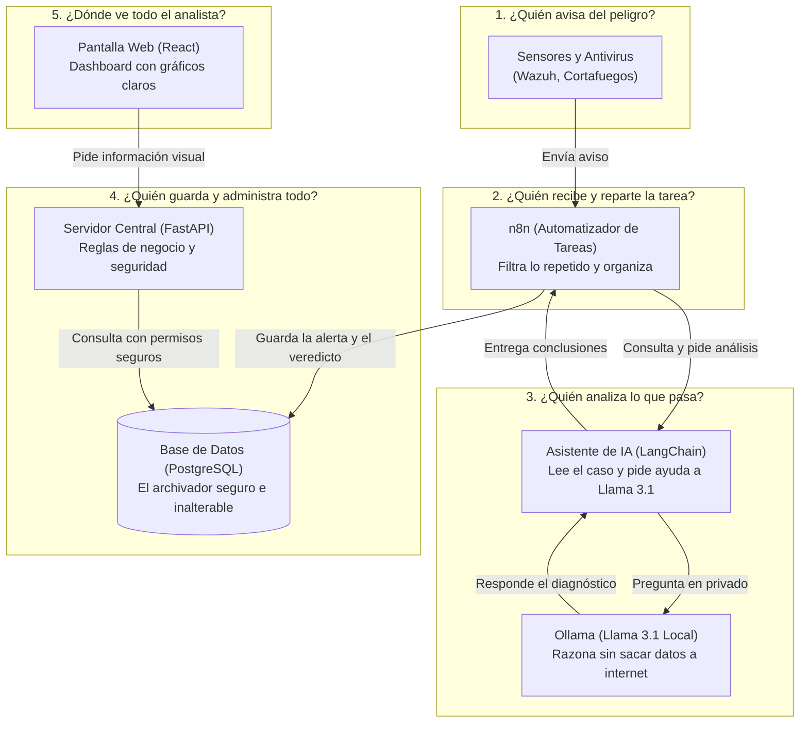
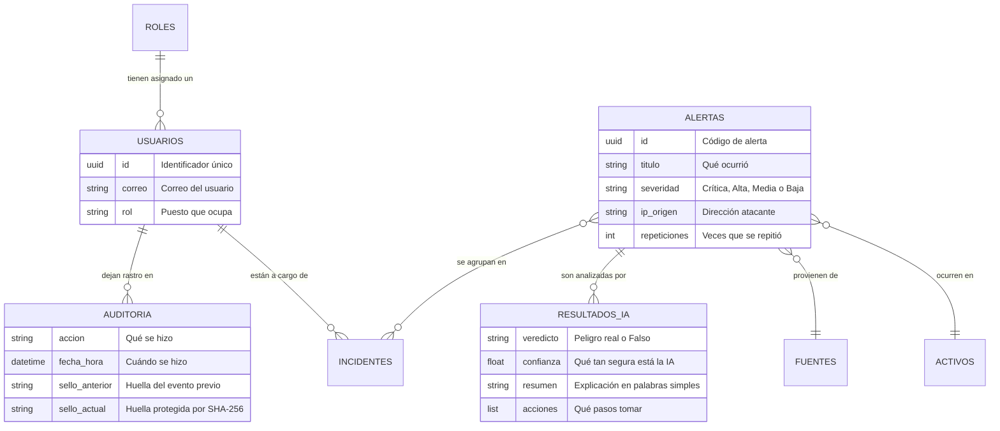
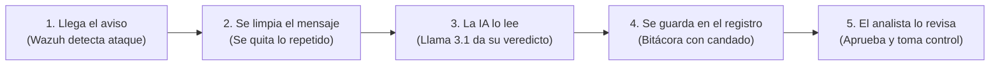

# INFORME DEL PROYECTO: SOC-LITE
## Plataforma Accesible para el Filtrado Inteligente de Alertas de Ciberseguridad con Inteligencia Artificial

---

## Índice General

1. [Índice General](#índice-general)
2. [Índice de Figuras y Tablas](#índice-de-figuras-y-tablas)
3. [Objetivos del Proyecto](#objetivos-del-proyecto)
   - 3.1. [Objetivo General](#1-objetivo-general)
   - 3.2. [Objetivos Específicos](#2-objetivos-específicos)
4. [Alcances y Limitaciones del Proyecto](#alcances-y-limitaciones-del-proyecto)
   - 4.1. [Alcances (¿Qué cubre el sistema?)](#alcances-qué-cubre-el-sistema)
   - 4.2. [Limitaciones (¿Qué aspectos quedan fuera o dependen del equipo?)](#limitaciones-qué-aspectos-quedan-fuera-o-dependen-del-equipo)
5. [Requerimientos y Funcionalidades del Sistema](#requerimientos-y-funcionalidades-del-sistema)
   - 5.1. [Funcionalidades Principales (Requerimientos Funcionales)](#funcionalidades-principales-requerimientos-funcionales)
   - 5.2. [Cualidades de Seguridad y Calidad (Requerimientos No Funcionales)](#cualidades-de-seguridad-y-calidad-requerimientos-no-funcionales)
   - 5.3. [Normas y Buenas Prácticas de Seguridad que Cumple](#normas-y-buenas-prácticas-de-seguridad-que-cumple)
6. [Diseño del Sistema](#diseño-del-sistema)
   - 6.1. [¿Cómo funciona el sistema en conjunto? (Arquitectura Explicada)](#cómo-funciona-el-sistema-en-conjunto-arquitectura-explicada)
   - 6.2. [Diseño de Interfaces y Pantallas del Sistema](#1-diseño-de-interfaces-y-pantallas-del-sistema)
   - 6.3. [Diseño de la Base de Datos: Estructura de Información](#2-diseño-de-la-base-de-datos-estructura-de-información)
7. [Tecnologías y Herramientas Utilizadas](#tecnologías-y-herramientas-utilizadas)
   - 7.1. [Lenguajes de Programación y Plataformas de Software](#1-lenguajes-de-programación-y-plataformas-de-software)
   - 7.2. [Herramientas de Soporte y Despliegue](#2-herramientas-de-soporte-y-despliegue)
8. [Implementación del Sistema](#implementación-del-sistema)
   - 8.1. [El Camino que Recorre una Alerta (Paso a Paso)](#el-camino-que-recorre-una-alerta-paso-a-paso)
   - 8.2. [El Asistente de Inteligencia Artificial](#el-asistente-de-inteligencia-artificial)
   - 8.3. [El Motor del Sistema y los Reportes](#el-motor-del-sistema-y-los-reportes)
   - 8.4. [La Interfaz Web de Usuario](#la-interfaz-web-de-usuario)
9. [Uso de Inteligencia Artificial en el Desarrollo del Proyecto](#uso-de-inteligencia-artificial-en-el-desarrollo-del-proyecto)
   - 9.1. [Herramientas de Inteligencia Artificial Utilizadas](#1-herramientas-de-inteligencia-artificial-utilizadas)
   - 9.2. [Registro de Instrucciones (Prompts) Principales](#2-registro-de-instrucciones-prompts-principales)
   - 9.3. [Resultados Obtenidos con la Inteligencia Artificial](#3-resultados-obtenidos-con-la-inteligencia-artificial)
   - 9.4. [Mejoras y Correcciones Hechas por los Estudiantes](#4-mejoras-y-correcciones-hechas-por-los-estudiantes)
   - 9.5. [Cómo Comprobamos que el Sistema Funciona Correctamente](#5-cómo-comprobamos-que-el-sistema-funciona-correctamente)
10. [Conclusiones](#conclusiones)
11. [Recomendaciones](#recomendaciones)
12. [Referencias Bibliográficas (Formato APA, 7.ª Edición)](#referencias-bibliográficas-formato-apa-7ª-edición)

---

## Índice de Figuras y Tablas

### Figuras
- **Figura 1:** Esquema visual de cómo interactúan las partes de SOC-Lite.
- **Figura 2:** Diagrama de cómo se organiza la información en la Base de Datos.
- **Figura 3:** Flujo de trabajo automatizado que analiza las alertas en n8n.
- **Figura 4:** Captura de Pantalla - Pantalla de Inicio de Sesión con Cuentas Rápidas de Prueba.
- **Figura 5:** Captura de Pantalla - Panel Principal (Dashboard) con Gráficos y Métricas.
- **Figura 6:** Captura de Pantalla - Bandeja de Alertas con Buscador y Filtros.
- **Figura 7:** Captura de Pantalla - Detalle de una Alerta con la Opinión de la IA y Aprobación del Analista.
- **Figura 8:** Captura de Pantalla - Módulo de Incidentes y Tiempos de Respuesta.
- **Figura 9:** Captura de Pantalla - Bitácora de Registro y Comprobación de Seguridad de los Datos.
- **Figura 10:** Captura de Pantalla - Descarga de Reportes en PDF, Word y Excel.
- **Figura 11:** Captura de Pantalla - Circuito Automatizado Funcionando en n8n.

### Tablas
- **Tabla 1:** Lista de Roles de Usuario y qué puede hacer cada uno.
- **Tabla 2:** Resumen de las Tecnologías utilizadas y para qué sirve cada una.
- **Tabla 3:** Historial de Instrucciones (Prompts) que guiaron la construcción del proyecto.
- **Tabla 4:** Problemas encontrados durante las pruebas y cómo los solucionamos.

---

## Objetivos del Proyecto

### 1. Objetivo General
Crear un sistema de seguridad digital accesible y fácil de usar, llamado **SOC-Lite**, pensado para pequeñas y medianas empresas o instituciones públicas. Su meta es ayudar a los analistas a **no saturarse de avisos de seguridad falsos**, usando un flujo de trabajo automatizado y un modelo de **Inteligencia Artificial local** que lee las alertas, explica lo que pasa en palabras sencillas y sugiere cómo actuar, manteniendo la privacidad de la empresa y protegiendo los registros para que nadie los pueda alterar.

### 2. Objetivos Específicos
1. **Evitar la avalancha de avisos repetidos:** Agrupar las alertas iguales para que el especialista no tenga que revisar 100 veces el mismo evento inofensivo.
2. **Explicar las alertas con Inteligencia Artificial:** Usar un modelo inteligente que resuma el peligro, diga si es una amenaza real o una falsa alarma y sugiera qué hacer de inmediato.
3. **Cuidar la privacidad de los datos:** Asegurarse de que la Inteligencia Artificial funcione dentro de la propia computadora de la empresa, sin enviar contraseñas, IPs ni información confidencial a servidores externos en internet.
4. **Tener un registro a prueba de trampas:** Crear un libro de visitas digital (bitácora) donde todo lo que pase quede guardado con un sello matemático seguro, evitando que alguien borre o modifique lo que hizo.
5. **Crear reportes fáciles de compartir:** Permitir la descarga de informes claros y ordenados en formatos cotidianos como PDF, Word y Excel.
6. **Ofrecer una pantalla cómoda y agradable:** Diseñar una interfaz visual moderna, limpia y adaptable a pantallas de celulares y computadoras, donde el analista siempre tenga la última palabra para aprobar las sugerencias de la IA.

---

## Alcances y Limitaciones del Proyecto

### Alcances (¿Qué cubre el sistema?)
- **Todo listo para funcionar:** El sistema completo corre dentro de contenedores de Docker, lo que permite encenderlo con un solo comando en cualquier computadora moderna sin instalaciones complejas.
- **Entiende múltiples fuentes de seguridad:** Recibe avisos de antivirus y sistemas de detección comunes como Wazuh, cortafuegos como OPNsense o alertas ingresadas a mano por el equipo.
- **Investigación automática:** Cuando llega una alerta con una dirección sospechosa de internet, el sistema busca antecedentes de virus y clasifica el tipo de ataque con el estándar internacional de ciberseguridad (MITRE ATT&CK).
- **Perfiles de usuario claros:** Cuenta con 5 tipos de usuario (desde el Analista que atiende las alertas, hasta el Auditor que solo revisa y el Administrador que configura el sistema).
- **Control de tiempos (SLA):** Alerta al equipo si un incidente grave está tardando demasiado tiempo en resolverse.

### Limitaciones (¿Qué aspectos quedan fuera o dependen del equipo?)
- **Velocidad de la computadora:** Dado que la Inteligencia Artificial funciona directamente en la máquina para proteger la privacidad, si la computadora no tiene una tarjeta gráfica moderna, las respuestas de la IA pueden tardar entre 10 y 20 segundos por cada alerta.
- **Servicios externos de pago:** Si la empresa no cuenta con claves de internet para consultar bases de datos de virus externas (como VirusTotal), el sistema no falla, pero se limita a analizar lo que conoce dentro de su propia red.
- **Integraciones con chat:** La conexión con herramientas como Slack o sistemas de tickets se incluye de forma opcional; para las pruebas iniciales pueden apagarse sin que el programa deje de funcionar.

---

## Requerimientos y Funcionalidades del Sistema

### Funcionalidades Principales (Requerimientos Funcionales)

1. **Ingreso Seguro y Accesible:**
   - Inicio de sesión con contraseñas protegidas.
   - Para no perder tiempo escribiendo correos largos durante las pruebas o demostraciones, la pantalla incluye botones rápidos para elegir usuarios de muestra con un solo clic.
2. **Recepción Inteligente de Avisos:**
   - El sistema recibe las alertas en tiempo real.
   - Si la misma amenaza se repite 50 veces en 2 minutos, el sistema no satura la pantalla con 50 tarjetas: cuenta las repeticiones y mantiene una sola alerta ordenada.
3. **Dictamen de la Inteligencia Artificial:**
   - La IA evalúa la situación y emite un veredicto claro: *Verdadero peligro*, *Sospechoso*, *Falsa alarma* o *Inofensivo*.
   - Acompaña su veredicto con una explicación breve y hasta 5 consejos prácticos de solución (por ejemplo: "Bloquear la IP en el cortafuegos" o "Reiniciar contraseña del usuario").
4. **Validación del Especialista Humano:**
   - La IA nunca toma decisiones a ciegas ni reemplaza a las personas. El analista revisa lo sugerido, escribe su propio comentario y confirma el veredicto final.
5. **Conversión a Incidentes:**
   - Si una alerta resulta ser un ataque confirmado, se convierte en un "Incidente de Seguridad" con un número oficial (ejemplo: `INC-2026-0001`) y una fecha límite para solucionarlo.
6. **Bitácora Inalterable:**
   - Cada clic, inicio de sesión, cambio de estado y reporte queda apuntado para siempre con la hora exacta y quién lo hizo.
7. **Reportes Listos para la Gerencia:**
   - Con un botón se generan documentos ejecutivos en PDF, Word y hojas de cálculo en Excel para presentar el estado de la seguridad de la empresa.

### Cualidades de Seguridad y Calidad (Requerimientos No Funcionales)

- **Máxima Confidencialidad:** Toda la información sensible se queda en la empresa. La Inteligencia Artificial trabaja en la red local.
- **Imposible de Borrar:** Los registros de auditoría tienen un candado digital en la base de datos que no permite borrar ni editar lo ocurrido.
- **Rapidez de Consulta:** Las pantallas cargan de inmediato gracias a una comunicación moderna y rápida entre la interfaz y el servidor.
- **Diseño Adaptable:** Los botones, tablas y tarjetas se reorganizan de manera limpia tanto en monitores grandes como en pantallas pequeñas de laptops o celulares.

### Normas y Buenas Prácticas de Seguridad que Cumple

- **Norma Internacional ISO 27001:**
  - *Control de Registro de Eventos (A.8.15):* Cumplido con la bitácora que anota cada acción.
  - *Respuesta a Incidentes (A.5.24):* Cumplido con el panel que clasifica y atiende los ataques según su gravedad.
  - *Manejo de Permisos (A.8.2):* Cada empleado solo tiene acceso a lo que su puesto de trabajo necesita ver.
- **Marco de Seguridad NIST CSF:**
  - *Detección de Anomalías (DE.AE):* La IA identifica rápidamente patrones extraños en el tráfico de la red.
  - *Análisis Rápido (RS.AN):* Reduce el tiempo de análisis de horas a solo minutos.

---

## Diseño del Sistema

### ¿Cómo funciona el sistema en conjunto? (Arquitectura Explicada)

El sistema está construido como un equipo de especialistas digitales donde cada uno tiene una tarea clara:

*Figura 1: Esquema visual de cómo interactúan las partes de SOC-Lite.*

1. Los **sensores** detectan que alguien intentó entrar con una contraseña incorrecta varias veces y le mandan una notificación a **n8n**.
2. **n8n** junta los avisos repetidos para no molestar y le pasa el caso a la **Inteligencia Artificial**.
3. El modelo **Llama 3.1** lee el contexto en milésimas de segundo y responde: *"Es un ataque de fuerza bruta SSH real, sugiero bloquear la dirección IP"*.
4. Todo se archiva en la **Base de Datos** bajo llave.
5. El especialista abre su **página web**, ve la alerta en color rojo, lee la explicación de la IA y con un solo botón aplica la recomendación.

---

### 1. Diseño de Interfaces y Pantallas del Sistema

Para que la herramienta no resultara intimidante ni confusa, se tomó como inspiración la interfaz moderna **BankDash** (usada habitualmente en aplicaciones bancarias limpias y profesionales):

- **Fondo Suave y Descansado:** Fondo en gris tenue (`#F5F7FA`) para no cansar la vista en turnos largos de trabajo.
- **Tarjetas Blancas y Bordes Suaves:** Cada bloque de información está contenido en cajas blancas con esquinas redondeadas.
- **Colores con Significado Claro:**
  - Azul Eléctrico (`#2D60FF`): Botones principales y acciones importantes.
  - Rojo / Coral (`#FE5C73`): Incidentes críticos y urgentes.
  - Naranja y Ámbar (`#FEAA09` / `#FFBB38`): Advertencias y peligros medios.
  - Verde Menta (`#16DBCC`): Avisos resueltos, casos seguros o confirmaciones exitosas.

#### Pantallas Principales:
1. **Inicio de Sesión:** Permite ingresar con credenciales o hacer clic sobre una de las 4 tarjetas de muestra (Analista María, Auditora Carla, Administradora Ana o Jefe Luis) para rellenar los datos automáticamente.
2. **Panel Principal (Dashboard):** Muestra tarjetas grandes con el resumen del día: cuántas alertas hay, cuántas son peligrosas, qué tan confiable fue la IA hoy y gráficos de tendencia.
3. **Bandeja de Alertas:** Una lista ordenada con filtros para ver sólo lo urgente, buscar por texto o filtrar por origen.
4. **Ficha de Detalle de Alerta:** Muestra los datos de la máquina afectada a la izquierda y el diagnóstico completo de la IA a la derecha, con espacio abajo para que el analista escriba su aprobación.
5. **Libro de Bitácora:** Una tabla con candado donde se verifica con un clic que nadie haya modificado ningún registro.

> [!NOTE]
> **[INSERTAR FIGURA 4: Captura de pantalla de la vista Login con el selector de cuentas demo]**

> [!NOTE]
> **[INSERTAR FIGURA 5: Captura de pantalla del Dashboard principal mostrando métricas y gráficos]**

> [!NOTE]
> **[INSERTAR FIGURA 6: Captura de pantalla de la Bandeja de Alertas con filtros activos]**

> [!NOTE]
> **[INSERTAR FIGURA 7: Captura de pantalla del Detalle de Alerta con el dictamen de IA y validación humana]**

> [!NOTE]
> **[INSERTAR FIGURA 8: Captura de pantalla de la Gestión de Incidentes con los badges de SLA]**

> [!NOTE]
> **[INSERTAR FIGURA 9: Captura de pantalla de la Bitácora de Auditoría con la verificación SHA-256 exitosa]**

> [!NOTE]
> **[INSERTAR FIGURA 10: Captura de pantalla del Centro de Reportes con las opciones PDF, Word y Excel]**

---

### 2. Diseño de la Base de Datos: Estructura de Información

La información se guarda en **PostgreSQL 16**, repartida en cajones ordenados (tablas) que se relacionan entre sí:

*Figura 2: Diagrama de cómo se organiza la información en la Base de Datos.*

- **Protección de Auditoría:** Cada fila que entra a la bitácora calcula una firma matemática uniendo la firma de la fila anterior con el contenido de la actual. Es como una cadena: si alguien intenta cambiar una palabra en un evento del mes pasado, la cadena entera se rompe de inmediato y el sistema avisa del fraude.
- **Regla de Solo Agregar:** La base de datos tiene una regla automática: está terminantemente prohibido borrar o editar cualquier evento de la bitácora.

---

## Tecnologías y Herramientas Utilizadas

### 1. Lenguajes de Programación y Plataformas de Software

| Herramienta | Tipo | ¿Para qué sirve en este proyecto? |
| :--- | :--- | :--- |
| **Python 3.11** | Lenguaje de Servidor | Ejecuta el servidor principal y conecta las herramientas de inteligencia artificial de forma rápida y segura. |
| **FastAPI** | Framework Web | Es el intermediario que atiende las solicitudes de la página web y entrega los datos de inmediato. |
| **LangChain** | Motor para IA | Permite darle instrucciones claras al modelo de lenguaje y obligarlo a responder de forma ordenada. |
| **React 18 y TypeScript** | Interfaz Web | Construyen las pantallas interactivas que ve el usuario en el navegador, asegurando que no haya fallas de programación. |
| **Tailwind CSS** | Diseño Visual | Da el estilo visual moderno, los colores agradables y hace que la pantalla se ajuste a celulares y monitores. |
| **PostgreSQL 16** | Base de Datos | Almacena toda la información del sistema de manera sólida y confiable. |
| **n8n (v1.72.1)** | Automatizador Visual | Conecta los sistemas entre sí mediante bloques gráficos, como si fueran piezas de Lego. |
| **Ollama y Llama 3.1 (8B)** | Inteligencia Artificial | El cerebro que lee las alertas en español, entiende el ataque y sugiere las soluciones sin enviar nada a internet. |

*Tabla 2: Resumen de las Tecnologías utilizadas y para qué sirve cada una.*

### 2. Herramientas de Soporte y Despliegue

- **Docker y Docker Compose:** Permite meter todo el sistema dentro de "cajas virtuales" (contenedores). Gracias a esto, no hace falta instalar Python, bases de datos ni programas adicionales en la computadora del usuario: con un solo comando se inicia todo junto.
- **Redis:** Memoria ultra-rápida temporal para controlar inicios de sesión y evitar que alguien intente probar muchas contraseñas seguidas para adivinarlas.
- **ReportLab, Python-Docx y XlsxWriter:** Pequeños programas especializados que dibujan y construyen los archivos en formato PDF, documentos de Word y hojas de Excel con diseño profesional.

---

## Implementación del Sistema

### El Camino que Recorre una Alerta (Paso a Paso)

Para entender cómo funciona el sistema en la práctica, sigamos el viaje de una alerta cuando un ciberatacante intenta vulnerar la empresa:

*Figura 3: Flujo de trabajo automatizado que analiza las alertas en n8n.*

1. **El detector da la alarma:** Una computadora conectada al sistema (como el cortafuegos) nota que desde una dirección IP desconocida se intentó entrar 100 veces por la fuerza y manda el aviso a **n8n**.
2. **Se eliminan duplicados:** n8n revisa si esa misma dirección ya había sido registrada en los últimos minutos. Como es la misma, no llena la base de datos de basura; solo suma un número al contador de repeticiones.
3. **El asistente inteligente interviene:** n8n le pasa los detalles al microservicio de IA. En pocos segundos, el modelo Llama 3.1 revisa la técnica de ataque y redacta un dictamen comprensible.
4. **Registro seguro:** La alerta y su dictamen se guardan en la base de datos y se crea un registro sellado en la bitácora que nadie puede borrar.
5. **El analista actúa:** En la pantalla web del analista aparece la nueva alerta en color rojo. Al abrirla, el analista lee el resumen, confirma las recomendaciones sugeridas por la IA y resuelve el incidente con tranquilidad.

> [!NOTE]
> **[INSERTAR FIGURA 11: Captura de pantalla del circuito automatizado funcionando en n8n con todos los nodos en verde]**

### El Asistente de Inteligencia Artificial

El servicio de IA no inventa respuestas libres. Tiene una orden muy estricta:
- Debe responder siempre con una estructura fija que incluye:
  - **Veredicto:** ¿Es un ataque real o falso?
  - **Severidad sugerida:** ¿Qué tan grave es?
  - **Nivel de confianza:** ¿Qué tan segura está la IA de su respuesta (del 0% al 100%)?
  - **Resumen:** Una explicación clara de 2 o 3 líneas.
  - **Pasos a seguir:** Lista ordenada con acciones concretas para proteger a la empresa.

### El Motor del Sistema y los Reportes

El servidor principal se asegura de que nadie vea cosas que no le corresponden:
- **El Analista** puede investigar alertas y cambiar estados.
- **El Auditor** solo puede ver los datos y comprobar que no hayan sido adulterados.
- **El Administrador** puede crear usuarios.
- Además, el generador de reportes permite seleccionar un rango de fechas y con un clic produce un archivo descargable (PDF, Word o Excel) con gráficos y tablas listos para imprimir o adjuntar por correo.

### La Interfaz Web de Usuario

La página web está pensada para ser intuitiva:
- Si entras desde una computadora de escritorio con pantalla ancha, verás tablas completas con muchos datos técnicos.
- Si entras desde una laptop pequeña o un teléfono móvil, las tablas se transforman automáticamente en tarjetas legibles que no requieren desplazarse hacia los lados.

---

## Uso de Inteligencia Artificial en el Desarrollo del Proyecto

### 1. Herramientas de Inteligencia Artificial Utilizadas

Durante la realización de este trabajo de laboratorio se emplearon tres herramientas de IA con propósitos bien diferenciados:
1. **DeepSeek Harness:** Se usó al inicio para crear el esqueleto inicial del código a partir de la consigna de la práctica.
2. **Antigravity (Asistente de Google DeepMind):** Actuó como compañero de programación en equipo, ayudando a diagnosticar fallas de compatibilidad, corregir errores en la base de datos, reprogramar nodos en n8n y rediseñar por completo la apariencia estética de la página web.
3. **Meta Llama 3.1 8B (dentro del software final):** Es la IA que quedó integrada dentro del producto final para atender las alertas de ciberseguridad.

### 2. Registro de Instrucciones (Prompts) Principales

La siguiente tabla resume los pedidos clave que se hicieron durante el proyecto para llegar al resultado final:

| Paso | Objetivo de la Instrucción | ¿Qué se le pidió a la IA en palabras simples? |
| :---: | :--- | :--- |
| **1** | Creación inicial | *"Genera una solución completa para SOC-Lite que use n8n, LangChain, PostgreSQL, reportes en PDF/Word/Excel y control de acceso por roles."* |
| **2** | Arranque del sistema | *"El backend no inicia al ejecutar docker compose up. Diagnostica y realiza lo necesario para compilar y levantar el software."* |
| **3** | Corrección de errores | *"Al entrar a Alertas y Auditoría me sale Error 500. Corrige estos errores, haz la web adaptable a móviles y mejora los reportes PDF."* |
| **4** | Facilidad para probar | *"Agrega en la pantalla de login un selector de cuentas de prueba para no tener que escribir contraseñas, y rediseña la web con los colores de la imagen BankDash adjunta."* |
| **5** | Ajuste visual del Login | *"El azul del panel izquierdo del login está demasiado fosforescente y cansa la vista. Cámbialo por un tono más sobrio y profesional."* |
| **6** | Verificación de consigna | *"Revisa el documento de la práctica de laboratorio y verifica punto por punto si lo que pide se está cumpliendo en el sistema."* |
| **7** | Nodos de n8n con error | *"Al importar el flujo en n8n me salen triángulos rojos de advertencia. Explícame cómo solucionarlos considerando la versión de n8n."* |
| **8** | Falla de librería en n8n | *"El nodo de normalizar alerta me da el error: Cannot find module 'crypto'. ¿Cómo lo resolvemos?"* |
| **9** | Falla de base de datos en n8n | *"El nodo de bitácora da el error: invalid input syntax for type uuid. Corrige la consulta SQL para que el circuito termine en verde."* |
| **10** | Organización visual | *"El texto y los botones en el detalle de la alerta quedan muy apretados arriba y desbordan la tarjeta. Distribúyelos de forma limpia."* |

*Tabla 3: Historial de Instrucciones (Prompts) que guiaron la construcción del proyecto.*

### 3. Resultados Obtenidos con la Inteligencia Artificial

- Se generó la estructura de un sistema completo compuesto por 7 servicios interconectados en Docker.
- Se obtuvo un diseño visual profesional con paleta corporativa y gráficas interactivas.
- Se logró que un modelo de lenguaje local (Llama 3.1) responda con precisión técnica sobre incidentes de seguridad en idioma español.

### 4. Mejoras y Correcciones Hechas por los Estudiantes

La Inteligencia Artificial no entregó un sistema perfecto a la primera; requirió supervisión, pruebas y adaptaciones importantes realizadas por los alumnos:

| Módulo o Pantalla | ¿Qué problema tenía el código generado por la IA? | ¿Cómo lo solucionamos nosotros? |
| :--- | :--- | :--- |
| **Base de Datos** | La aplicación fallaba al leer direcciones IP porque intentaba tratarlas como texto simple en vez del formato especial de red (`INET`). | Ajustamos los esquemas en el código Python para que entienda direcciones IP modernas y tradicionales sin errores. |
| **Permisos de Auditoría** | La base de datos bloqueaba los intentos del propio sistema de registrar eventos automáticos en la bitácora. | Corregimos las políticas de seguridad interna de la base de datos para permitir que los servicios autorizados anoten sus registros. |
| **Circuito de n8n (Módulo Crypto)** | El nodo de código intentaba usar una librería del sistema operativo que n8n bloquea por seguridad, impidiendo que el flujo continuara. | Escribimos una función matemática propia en JavaScript directo dentro del nodo que calcula la firma sin pedir permisos especiales. |
| **Circuito de n8n (Identificador de Tarea)** | El nodo intentó guardar el número de ejecución simple `"3"` en un campo que exigía un código largo de tipo UUID. | Corregimos la orden SQL para que genere un identificador único válido y guarde el número de ejecución como dato complementario. |
| **Inicio de Sesión** | Escribir correos largos y contraseñas complejas para probar cada rol hacía que las pruebas fueran lentas y tediosas. | Diseñamos un bloque con 4 tarjetas para hacer clic y autocompletar usuario y clave al instante según el rol a evaluar. |
| **Diseño Visual de Tarjetas** | En la pantalla de alerta, el botón azul de registrar veredicto se salía de la tarjeta blanca y se montaba sobre otros textos. | Reorganizamos el espacio en una cuadrícula flexible de 12 columnas que le da a cada botón e input su lugar exacto sin desbordarse. |

*Tabla 4: Problemas encontrados durante las pruebas y cómo los solucionamos.*

### 5. Cómo Comprobamos que el Sistema Funciona Correctamente

Siguiendo la indicación expresa de **no realizar pruebas automáticas a ciegas por parte de la IA**, cada funcionalidad fue probada manualmente por los estudiantes frente a la pantalla:

1. **Prueba de Inyección de Ataque:** Enviamos una alerta simulada de un atacante intentando forzar una contraseña. Vimos cómo en n8n cada bloque se iluminaba en verde y cómo la alerta aparecía de inmediato en la pantalla web con la etiqueta "ALTA".
2. **Prueba del Asistente:** Abrimos la alerta y comprobamos que el texto explicativo redactado por la IA coincidía con la realidad y recomendaba aislar la máquina correctamente.
3. **Prueba de Decisión Humana:** Seleccionamos la opción de confirmar el ataque, escribimos una nota técnica y pulsamos "Registrar Veredicto". La alerta cambió de estado y quedó registrada.
4. **Prueba del Candado de Seguridad:** Fuimos a la pestaña de Auditoría y presionamos el botón para verificar las firmas. El sistema revisó evento por evento y confirmó que la cadena estaba 100% sana e intacta.
5. **Prueba de Descarga:** Solicitamos un informe de la semana en formato PDF y otro en Excel; ambos se abrieron en la computadora con sus tablas y gráficos completos.

---

## Conclusiones

1. **La ciberseguridad avanzada sí puede estar al alcance de todos:** Este proyecto demuestra que una pequeña empresa o entidad estatal no necesita gastar fortunas en software privativo para tener un centro de operaciones de seguridad moderno, eficiente y automatizado.
2. **La Inteligencia Artificial es una gran aliada si se usa con privacidad:** El uso de modelos locales como Llama 3.1 demuestra que es posible gozar de la ayuda y el razonamiento de la IA sin poner en riesgo la privacidad de los clientes ni filtrar datos hacia servidores en otros países.
3. **La tecnología no reemplaza el criterio de las personas:** El sistema está diseñado bajo el principio de que la IA aconseja, pero el analista decide (*Human-in-the-Loop*). Esto evita que una mala interpretación de la máquina cause un bloqueo accidental de servicios legítimos de la empresa.
4. **El valor del trabajo guiado y supervisado:** La inteligencia artificial facilitó enormemente la escritura del código base, pero fue la intervención, depuración y criterio práctico del equipo humano lo que convirtió un conjunto de archivos sueltos en un sistema real, funcional y estable.

---

## Recomendaciones

1. **Contar con buen hardware para la IA:** Si se va a instalar este sistema en una oficina real, conviene usar una computadora que cuente con una tarjeta de video para que la inteligencia artificial responda en 1 o 2 segundos en lugar de tomarse 15 segundos.
2. **Conectar canales de mensajería del equipo:** Una vez que el sistema esté operando de forma continua, es muy útil vincularlo con un canal de Slack, Microsoft Teams o Telegram para que los analistas de guardia reciban una alerta en su celular cuando ocurra un ataque crítico fuera del horario de oficina.
3. **Mantener actualizadas las contraseñas:** Cambiar con periodicidad las claves de los archivos de configuración (`.env`) para mantener una postura de seguridad sólida y profesional.
4. **Hacer copias periódicas de la base de datos:** Respaldar con regularidad el archivador digital para asegurar que el historial de incidentes esté protegido ante cualquier falla física de la computadora.

---

## Referencias Bibliográficas (Formato APA, 7.ª Edición)

- Chase, H. (2024). *LangChain: Construcción de aplicaciones con modelos de lenguaje extensos mediante componibilidad*. https://www.langchain.com/
- Instituto Nacional de Estándares y Tecnología. (2018). *Marco para la mejora de la ciberseguridad en infraestructuras críticas (Versión 1.1)*. Departamento de Comercio de los Estados Unidos. https://doi.org/10.6028/NIST.CSWP.04162018
- Meta AI. (2024). *La familia de modelos Llama 3: Avances en modelos de lenguaje abiertos*. arXiv preprint. https://doi.org/10.48550/arXiv.2407.21783
- MITRE Corporation. (2024). *Matriz empresarial de tácticas y técnicas de adversarios (MITRE ATT&CK®)*. https://attack.mitre.org/
- n8n GmbH. (2024). *Plataforma de automatización de flujos de trabajo basada en código justo (Versión 1.72)*. https://n8n.io/
- Organización Internacional de Normalización. (2022). *Seguridad de la información, ciberseguridad y protección de la privacidad: Sistemas de gestión de la seguridad de la información (Norma ISO/IEC 27001:2022)*. https://www.iso.org/standard/27001
- The PostgreSQL Global Development Group. (2024). *Documentación oficial de PostgreSQL 16: Seguridad a nivel de filas y módulo pgcrypto*. https://www.postgresql.org/docs/16/
- Tiangolo, S. (2024). *FastAPI: Framework moderno y de alto rendimiento para APIs con Python (Versión 0.115)*. https://fastapi.tiangolo.com/

